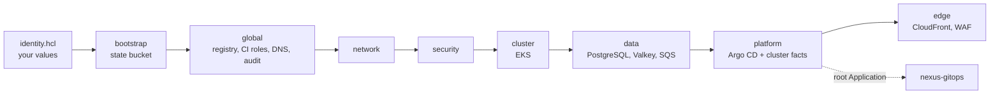

# Nexus Platform

The AWS infrastructure of Nexus, written with Terraform and Terragrunt. It
builds the network, the EKS cluster, the databases and queues, the public edge,
and installs Argo CD, which then takes over everything that runs inside
Kubernetes.

## About Nexus

Nexus is a project I built to run a production-style platform on AWS from
start to finish: the infrastructure, the Kubernetes platform on top of it, and
two small services that use all of it. The services are deliberately simple;
the platform around them is the point. The work is split into three
repositories, the way a team would split ownership:

| Repository | What it holds |
| --- | --- |
| **nexus-platform** (this one) | AWS infrastructure with Terraform and Terragrunt |
| [nexus-gitops](https://github.com/SergeAbroyan/nexus-gitops) | Everything that runs inside Kubernetes, deployed by Argo CD |
| [nexus-applications](https://github.com/SergeAbroyan/nexus-applications) | The Go API, the Java worker, and their delivery pipeline |

The environments cost money while they run, so I destroy them when I am not
using them. This code rebuilds DEV from an empty AWS account in about an hour.
The screenshots below come from the last rebuild, on 9 November 2026. More of
them, with the problems I found on the way, are on my portfolio at
[sergeabroyan.com/projects/nexus](https://sergeabroyan.com/projects/nexus/).

## What I built here

- **One codebase, three environments.** `dev`, `staging`, and `production` use
  the same Terragrunt units. Two settings per environment, the number of
  Availability Zones and whether a standby region exists, decide how big it
  is, so DEV runs in one zone on Spot nodes and production in three zones with
  a second region on standby.
- **The AWS foundation.** A VPC with private subnets and VPC endpoints, EKS
  with Karpenter, PostgreSQL on RDS, Valkey on ElastiCache, and SQS, all
  encrypted with their own KMS keys.
- **A private origin.** Visitors reach the application through CloudFront and
  AWS WAF, which connect to an internal load balancer through a VPC origin. No
  part of the cluster has a public address.
- **Admin tools without an open port.** Argo CD, Grafana, Prometheus, and the
  other tools are published through a Cloudflare Tunnel that only dials out,
  and Cloudflare Access asks for a one-time code before any of them loads.
- **The GitOps bridge.** Terraform installs Argo CD and gives it one root
  Application together with the facts it knows about AWS: role ARNs, queue
  URLs, database endpoints. From there,
  [nexus-gitops](https://github.com/SergeAbroyan/nexus-gitops) deploys the
  rest.
- **No secrets in Git or Terraform state.** Passwords are generated by AWS or
  passed as ephemeral, write-only values, and CI reaches AWS through GitHub
  OIDC without stored keys.
- **Account guardrails.** CloudTrail with an encrypted audit bucket, a monthly
  budget with email alerts, IAM Access Analyzer, and optional GuardDuty and
  Security Hub.
- **Written decisions.** Ten [architecture decision records](docs/adr/README.md)
  explain the main choices and the alternatives I rejected.

## How it fits together

Each environment is a set of Terragrunt units applied in dependency order.
`global` holds what the whole account shares, such as the image registry, the
CI roles, and the Cloudflare zone.



## See it running

| | |
| --- | --- |
|  |  |
| All 37 applications synced and healthy after a rebuild from empty | The admin tools sit behind Cloudflare Access, with no inbound port |
|  |  |
| PostgreSQL, Valkey, and SQS metrics from CloudWatch in Grafana | OpenCost splits the cluster's cost by namespace |

## Run it yourself

You need Terraform 1.11 or later, Terragrunt 1.1.5 or later, the AWS CLI,
`kubectl`, credentials for an AWS account, and a domain you own.
[Getting started](docs/getting-started.md) has every command; in short:

1. Copy `infrastructure/live/identity.example.hcl` to `identity.hcl` and fill
   in your account, domain, email, and GitHub owner. Git ignores this file, and
   Terragrunt refuses to touch AWS until it exists.
2. Create the Terraform state bucket from `infrastructure/bootstrap`.
3. Apply `infrastructure/live/global`, then store the read-only deploy key that
   Argo CD uses to read `nexus-gitops`.
4. Deploy DEV and connect to the cluster:

   ```bash
   cd infrastructure/live/dev
   terragrunt run --all apply
   aws eks update-kubeconfig --name nexus-dev-use1 --region us-east-1
   kubectl get applications -n argocd
   ```

5. Wait until every Application is `Synced` and `Healthy`, then connect the
   pipelines of the three repositories as [CI and deployment](docs/ci-cd.md)
   describes.

DEV costs about $0.40 an hour while it runs, mostly for EKS, the NAT gateway,
and the database; [Cost](docs/cost.md) breaks it down. With a Cloudflare
account configured, the admin tools open at `https://argocd-dev.<your
domain>` and similar addresses.

## Tear it down

Karpenter nodes and Kubernetes volumes are not Terraform resources, so they
have to go first, or they block the network from being deleted.
[Operations](docs/operations.md#destroying) lists the commands: stop Argo CD,
remove the node pools, run `terragrunt run --all destroy` in the environment,
and then check for the leftovers it describes, such as unattached volumes and
network interfaces. `global` costs about $4 a month and can stay, so the next
rebuild is one command.

## What went wrong along the way

Building and rebuilding this found real problems, and each one is fixed in
code. A few from this repository:

- Removing an unused Route 53 zone made its Terraform output null, Terraform
  dropped it from state, and the next rebuild failed at the very last unit.
- Only one of Kyverno's two controllers had AWS credentials, so its background
  signature checks failed with a 401 from ECR while admission checks passed.
- EKS audit logs alone cost about $5 a day on an idle DEV cluster, so DEV now
  sends every control plane log type except `audit`.

The full list, with causes, fixes, and lessons, is at
[sergeabroyan.com/incidents](https://sergeabroyan.com/incidents/).

## Repository layout

```text
infrastructure/
├── bootstrap/        The S3 bucket for Terraform state
├── modules/          One Terraform module per unit: global, network, security,
│                     cluster, data, platform, edge
└── live/
    ├── identity.example.hcl   Template for your personal values
    ├── account.hcl            Settings shared by every environment
    ├── _units/                Terragrunt units, written once
    ├── global/                Account-wide resources
    └── dev/, staging/, production/   One folder per environment and region
docs/                 Guides and decision records
.github/workflows/    Validation, deployment, and cost estimates
```

## Documentation

| Page | Contents |
| --- | --- |
| [Getting started](docs/getting-started.md) | Prerequisites, your values, the state bucket, the first deployment |
| [Architecture](docs/architecture.md) | Environments, architecture, repository structure, dependency order |
| [Kubernetes platform](docs/kubernetes-platform.md) | GitOps bridge, admin tools, Argo CD sign-in, admission policies, ingress |
| [Operations](docs/operations.md) | Growing and destroying environments, disaster recovery, backups, resilience experiments |
| [Security](docs/security.md) | Account security services |
| [Observability](docs/observability.md) | Alerts and observability |
| [Cost](docs/cost.md) | What the platform costs and how to keep it low |
| [CI and deployment](docs/ci-cd.md) | Validation, deployment workflows, repository settings |
| [Decision records](docs/adr/README.md) | Why each major choice was made |
