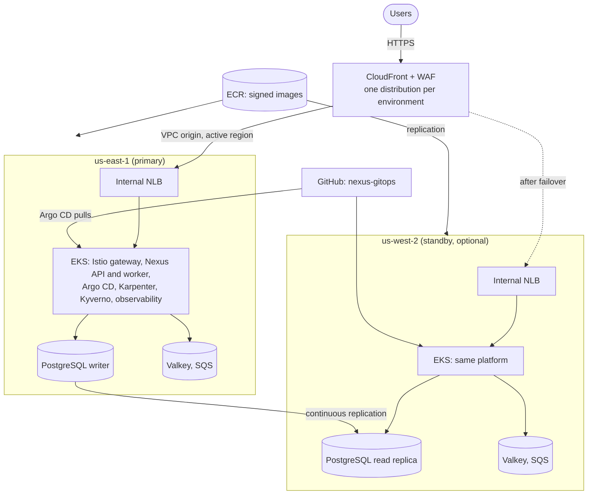

# Nexus Platform Infrastructure

This repository defines the AWS infrastructure for Nexus with Terraform modules
and Terragrunt. The code contains three environments, `dev`, `staging`, and
`production`, and each environment can run in two AWS Regions as an
active-passive pair across one to three Availability Zones. Two settings per
environment decide what is actually deployed, so the same code serves a small
DEV and a highly available production.

Application source code lives in `nexus-applications`. Everything that runs
inside Kubernetes, including every add-on, lives in `nexus-gitops`. Terraform
owns the AWS resources, installs Argo CD, and hands each cluster one root
Application together with the AWS facts that `nexus-gitops` needs.

## What each environment deploys

| Environment | Regions | Availability Zones | Purpose |
| --- | --- | --- | --- |
| `dev` | `us-east-1` | 1 | Low-cost development on Spot instances |
| `staging` | `us-east-1`, standby `us-west-2` | 3 | Production-like testing |
| `production` | `us-east-1`, standby `us-west-2` | 3 | Highly available service |

The switches are in each `environment.hcl`:

- `standby_enabled` turns the `us-west-2` standby region on or off. When it is
  off, `terragrunt run --all` skips every `us-west-2` unit of that environment
  and refuses `plan` and `apply` inside them.
- `availability_zone_count` sets how many zones run nodes, NAT gateways, the
  database, the cache, and the load balancer. EKS and RDS require subnets in at
  least two zones, so subnets always exist in all three zones; they cost
  nothing, and with a count of 1 everything that runs is placed in the first
  zone.

## Architecture



- CloudFront is the only public entry point. It reaches each region's internal
  Network Load Balancer through a CloudFront VPC origin, so no load balancer is
  exposed to the internet. `active_region` decides which region receives
  traffic.
- In an environment with the standby enabled, the standby PostgreSQL database
  is a continuous read replica of the primary, and the standby API serves reads
  without changing the schema until the replica is promoted.
- With three zones, each region has a NAT gateway per zone, Multi-AZ
  PostgreSQL, Valkey replicas in other zones, system nodes in several zones,
  and at least two Karpenter controllers.

## Repository structure

```text
infrastructure/
├── bootstrap/            One-time Terraform state bucket
├── modules/              Seven reusable Terraform modules
│   ├── global/           GitHub CI roles, Route 53 zone, ECR and replication, budget,
│   │                     shared secrets, CloudTrail, Access Analyzer, optional
│   │                     GuardDuty and Security Hub
│   ├── network/          VPC, subnets, NAT gateways, flow logs
│   ├── security/         KMS keys, Grafana secret, regional alert topic
│   ├── cluster/          EKS, managed system nodes, Karpenter AWS resources, FIS experiments
│   ├── data/             PostgreSQL, Valkey, SQS, CloudWatch alarms, AWS Backup
│   ├── platform/         Pod Identity roles, ingress NLB, Velero bucket, Argo CD and its seed objects
│   └── edge/             CloudFront, WAF, TLS certificate, application DNS records
└── live/
    ├── root.hcl          State backend, AWS provider, naming, region switch
    ├── identity.hcl      Personal values: AWS account, domain, email, GitHub owner, administrators
    ├── account.hcl       Account-wide settings shared by every environment
    ├── _units/           One definition per unit type
    ├── global/           Account-wide unit, applied once
    ├── dev/
    │   ├── environment.hcl
    │   ├── edge/
    │   ├── us-east-1/    region.hcl, network, security, cluster, data, platform
    │   └── us-west-2/    region.hcl, network, security, cluster, data, platform
    ├── staging/          Same layout as dev
    └── production/       Same layout as dev
.github/workflows/
├── validate.yaml             Formatting, validation, TFLint, and Checkov
├── deploy.yaml               Plan or apply one environment on demand
└── infracost.yaml            Monthly cost change of every pull request
renovate.json                 Dependency updates for modules, providers, tools, and actions
.pre-commit-config.yaml       Local checks before every commit
docs/adr/                     Architecture decision records
```

The [architecture decision records](docs/adr/README.md) explain the main
choices and the alternatives that were rejected.

Each unit folder holds a small `terragrunt.hcl` that includes `root.hcl` and its
definition in `_units/`, so every environment and region uses the same unit
code. Settings live in four places:

- `identity.hcl`: every value that belongs to the owner rather than the
  project: the AWS account ID, the domain, the alert email, the GitHub owner,
  and the administrators' IAM users, GitHub logins, and IP ranges. Someone who
  forks the project changes only this file.
- `account.hcl`: project settings shared by every environment: regions,
  repositories, Argo CD GitHub sign-in, GuardDuty, Security Hub, audit logs,
  budget, and container registry. It reads its personal values from
  `identity.hcl`.
- `<environment>/environment.hcl`: the switches above and every sizing and
  retention setting of that environment
- `<environment>/<region>/region.hcl`: the region's network ranges; each
  environment and region uses its own non-overlapping `/16`

The `global` unit is shared because all environments live in one AWS account.
The GitHub OIDC provider, the ECR repositories, the Route 53 zone, and the
budget can exist only once per account, and images are promoted between
environments by commit SHA from the same repositories. `global` also creates
one infrastructure CI role per environment and the secrets that every cluster
reads: the GitOps deploy key, the Slack webhook URL, and the GitHub OAuth
client secret.

Resources are named `nexus` for account-wide resources, `nexus-<environment>`
for the environment edge, and `nexus-<environment>-<region code>` for regional
resources, for example `nexus-dev-use1`.

## Dependency order

```text
global (applied once)

Each enabled region:   network ──┐
                       security ─┼─► cluster ─► data ─► platform
                       global ───┘

us-west-2/data also waits for us-east-1/data, the replica source.
edge waits for global and for the platform unit of each enabled region.
```

`terragrunt dag graph --working-dir infrastructure/live/dev` prints the graph.
Independent units run in parallel, and destroy uses the reverse order.

## Prerequisites

- Terraform 1.11 or later (CI uses 1.17.0) and Terragrunt 1.1.5 or later (CI uses 1.2.1);
  `root.hcl` refuses older versions
- AWS CLI, `curl`, and `kubectl` 1.35 to 1.37 for EKS 1.36
- Credentials for the `aws_account_id` in `identity.hcl`; the AWS provider
  refuses to run against any other account
- A domain that you own

The cluster unit adds the public IP address of whoever runs Terragrunt to the
EKS API allow list, detected with `https://checkip.amazonaws.com`. Put stable
administrator CIDRs in `administrators.cidrs` in `identity.hcl` so that an apply from CI
does not remove your own access.

## Configuration

Before the first deployment set:

- in `identity.hcl`: `domain_name`, so each environment is served at
  `<application_subdomain>.<domain_name>`, for example `nexus-dev.example.com`;
  `administrators.cidrs`, for example `["203.0.113.10/32"]`; and check
  `aws_account_id`, `alert_email_address`, `github_owner`, and the
  administrators' IAM users and GitHub logins
- `monthly_budget_amount_usd` in `account.hcl` if needed

Optional switches in `account.hcl`:

- `argocd_github_sso`: sign in to Argo CD with GitHub instead of the local
  `admin` account; see [Argo CD sign-in](#argo-cd-sign-in)
- `guardduty_enabled`: GuardDuty threat detection with EKS audit log and EKS
  runtime monitoring in both regions
- `security_hub_enabled`: AWS Config recording and Security Hub checks against
  the AWS Foundational Security Best Practices and CIS benchmarks in both
  regions; see [Account security](#account-security)
- `audit`: how long CloudTrail logs are kept, and whether destroying `global`
  deletes them

## Deployment

Move the bootstrap state into the existing state bucket once:

```bash
terraform -chdir=infrastructure/bootstrap init -migrate-state \
  -backend-config="bucket=nexus-terraform-state-$(aws sts get-caller-identity --query Account --output text)" \
  -backend-config="key=bootstrap/terraform.tfstate" \
  -backend-config="region=us-east-1" \
  -backend-config="encrypt=true" \
  -backend-config="use_lockfile=true"
```

Apply the account-wide unit and delegate the domain to its hosted zone:

```bash
cd infrastructure/live/global
terragrunt apply
terragrunt output name_servers
```

With `domain_registered_with_route53 = true` in `identity.hcl`, the apply
also points the domain at the new zone's name servers, and keeps them in step if
the zone is ever recreated. When Route 53 registered the domain, it created a
hosted zone of its own that is now unused; delete it once in the Route 53
console, or with `aws route53 delete-hosted-zone --id <its ID>`. For a domain
registered elsewhere, set the flag to `false` and enter the four name servers at
your registrar. Wait until `dig NS <domain>` returns the new name servers,
because the CloudFront certificate is validated through this zone.

Give Argo CD read access to `nexus-gitops`. Create a key pair, store the
private key in the secret that `global` created, and delete the local copy:

```bash
ssh-keygen -t ed25519 -N "" -C argocd-nexus-gitops -f argocd-gitops
aws secretsmanager put-secret-value --region us-east-1 \
  --secret-id nexus/argocd/gitops-deploy-key \
  --secret-string file://argocd-gitops
rm argocd-gitops
```

In GitHub, open `nexus-gitops` → Settings → Deploy keys → Add deploy key, paste
the contents of `argocd-gitops.pub`, leave **Allow write access** off, and then
delete `argocd-gitops.pub`. To replace the key later, store the new private
key, add its public key in GitHub, and increase
`platform.argocd.secrets_revision` in each `environment.hcl`.

To receive alerts in Slack as well as by email, create a Slack app with an
incoming webhook for the alert channel, store its URL, and set
`alerting.slack.enabled: true` in `nexus-gitops`:

```bash
aws secretsmanager put-secret-value --region us-east-1 \
  --secret-id nexus/alerts/slack-webhook-url \
  --secret-string 'https://hooks.slack.com/services/...'
```

Deploy an environment:

```bash
cd infrastructure/live/dev
terragrunt run --all plan
terragrunt run --all apply
```

With the DEV settings this deploys `us-east-1` in one zone plus the edge. Work
on one unit:

```bash
cd infrastructure/live/dev/us-east-1/data
terragrunt plan
terragrunt apply
```

A first `run --all plan` stops at units whose dependencies have no state yet;
`run --all apply` creates them in order. Mock outputs are deliberately not
used, because they can hide wiring errors.

After the first apply, AWS sends a subscription email for each regional alert
topic. Choose **Confirm subscription**, or no alerts arrive.

Connect to a cluster:

```bash
aws eks update-kubeconfig --name nexus-dev-use1 --region us-east-1
```

## Growing an environment

- More zones: raise `availability_zone_count`, set `nat_gateway_mode` to
  `one_per_az`, enable `multi_az` for the database and cache with at least two
  cache nodes, raise the node group sizes, and apply. Nodes, NAT gateways, the
  database standby, and cache replicas are added in the new zones.
- Standby region: set `standby_enabled = true` and run
  `terragrunt run --all apply`. The `us-west-2` units are created, its database
  starts as a replica of `us-east-1`, and CloudFront gains the second origin.

## Disaster recovery

This applies to environments with `standby_enabled = true`. Fail over to
`us-west-2`:

1. Set `active_region = "us-west-2"` in the environment's `environment.hcl`.
2. Promote the replica; this also creates a managed password secret for it:

   ```bash
   cd infrastructure/live/<environment>/us-west-2/data && terragrunt apply
   ```

3. Point External Secrets and the API at the promoted database's secret:

   ```bash
   cd ../platform && terragrunt apply
   ```

4. Send traffic to `us-west-2`:

   ```bash
   cd ../../edge && terragrunt apply
   ```

Promotion is one-way. To make `us-east-1` primary again, take a snapshot,
rebuild `us-east-1` as a replica of the promoted database, and switch
`active_region` back.

Limits: the Terraform state bucket and the CloudFront control plane are both in
`us-east-1`. During a complete `us-east-1` outage, promote the replica with
`aws rds promote-read-replica` and accept that CloudFront changes may be
delayed. A production setup should replicate the state bucket to the standby
region.

## Backups and recovery

Three layers protect data, each for a different failure:

| Layer | What it protects | Where it lives |
| --- | --- | --- |
| RDS automated backups | Point-in-time restore of the database for `backup_retention_days` | RDS, same region |
| AWS Backup | Daily recovery points plus continuous backup of the database, kept for `data.backup.retention_days`: 7 days in DEV, 14 in staging, 35 in production | The `<name>-database` vault, encrypted with the RDS key |
| Velero | Kubernetes resources and volumes of the `nexus`, `cloudbeaver`, and `monitoring` namespaces, every night | The `<name>-velero-<account>` S3 bucket and EBS snapshots |

The AWS Backup vault is separate from the database: deleting the instance or
its automated backups leaves the vault's recovery points intact. In a standby
region the vault exists only after the replica is promoted. The Velero bucket
and snapshots stay in the cluster's region; the database replica covers the
loss of a region. Restore procedures are rehearsed in the drills of
`nexus-gitops`.

## Account security

`global` turns on account-wide controls in both regions:

- **CloudTrail:** one multi-region trail records every management API call to
  the `<name>-audit-<account>` bucket, encrypted with its own KMS key and with
  log file validation, kept for `audit.retention_days`.
- **IAM Access Analyzer:** reports any IAM role, KMS key, S3 bucket, or secret
  that is shared outside the account.
- **Cost Anomaly Detection:** AWS enables it by default with a daily email for
  unusual spending, so Terraform does not create a second monitor; check it
  under Billing → Cost Anomaly Detection.
- **GuardDuty** (`guardduty_enabled`) and **Security Hub**
  (`security_hub_enabled`) are off by default because they cost money. Security
  Hub needs AWS Config, which records resources once a day to keep its cost
  low; findings appear in the Security Hub console.

## Kubernetes platform

The platform unit follows the GitOps Bridge pattern. It installs Argo CD and
then a second Helm release, `argocd-gitops`, from the local chart
`modules/platform/charts/gitops`. That release holds two objects, both defined
in `modules/platform/bootstrap.tf`:

- the `bootstrap` AppProject, which may only create Argo CD `Application` and
  `AppProject` objects in the Argo CD namespace;
- the `bootstrap` Application, which renders the `bootstrap` chart in
  `nexus-gitops` and passes the cluster facts as its `cluster` Helm values.

The `bootstrap` chart creates every other Application, so add-on versions and
settings change through Git, not through Terraform. The release runs after
Argo CD because the Argo CD chart installs its CRDs as templates, and after the
Pod Identity roles so that controllers start with AWS credentials. Terraform
also configures the Argo CD health check for `Application` objects, which lets
the root Application roll out its children in sync waves: CRDs first, then the
controllers, then the node pools and storage class, then the workloads.

The cluster facts are everything `nexus-gitops` needs to know about AWS: the
environment, Region, cluster name, VPC, GitOps repository and revision,
application hostname, ingress port and target group, ECR registry, EBS key,
Karpenter node role and interruption queue, the alert topic, the Grafana
password secret, the Slack webhook secret, the CI identity that signs images,
the Velero backup bucket,
the PostgreSQL, Valkey, and SQS connection settings, and the namespace and name
of every service account that a Pod Identity role trusts.
Besides the Nexus services, Pod Identity roles exist for the AWS Load Balancer
Controller, External Secrets, Alertmanager, Grafana, Kyverno and Trivy Operator
(read the Nexus images), KEDA (read the queue depth), and Velero (write the
backup bucket); each may do only what its add-on needs. Terraform owns those
service accounts, defined once at the top of
`modules/platform/identities.tf` and, for Karpenter, in `environment.hcl`; the
add-ons that use them run in those namespaces. `values.schema.json` in the
`bootstrap` chart is the contract for the facts, so a missing or mistyped fact
fails the render. Application secrets never pass through Terraform state or
Git; External Secrets reads them from Secrets Manager with EKS Pod Identity.

`nexus-gitops` is private, so Argo CD reads it over SSH with a read-only GitHub
deploy key. The key lives in the Secrets Manager secret
`nexus/argocd/gitops-deploy-key`, which `global` creates and replicates to the
standby region. The platform unit reads it as an ephemeral value and hands it to
the Argo CD release as a write-only Helm value, so it is never written to
Terraform state or Git.

Argo CD exposes metrics for its application controller, API server, and
repository server, and the monitoring stack in `nexus-gitops` scrapes them and
alerts when an Application stays degraded or out of sync or fails to sync.

### Argo CD sign-in

Argo CD has no public endpoint; reach it with
`kubectl port-forward -n argocd svc/argocd-server 8080:80` and open
<http://localhost:8080>. By default you sign in as `admin` with the password in
the `argocd-initial-admin-secret` Secret.

To sign in with GitHub instead:

1. In GitHub, open Settings → Developer settings → OAuth Apps → New OAuth App,
   set the homepage to `http://localhost:8080` and the callback URL to
   `http://localhost:8080/api/dex/callback`, and generate a client secret. One
   app serves every cluster, because every cluster is reached the same way.
2. Store the client secret:

   ```bash
   aws secretsmanager put-secret-value --region us-east-1 \
     --secret-id nexus/argocd/github-oauth-client-secret \
     --secret-string '<client secret>'
   ```

3. In `account.hcl`, set `argocd_github_sso.enabled = true` and the app's
   `client_id`; the administrators are `administrators.github_logins` in
   `identity.hcl`. Then apply the
   platform unit.

Terraform then enables Dex with a GitHub connector, gives the listed logins the
`admin` role, gives everyone else no access, and disables the local `admin`
account. The client secret reaches Argo CD the same way as the deploy key: an
ephemeral read and a write-only Helm value. After rotating it, increase
`platform.argocd.secrets_revision`.

### Admission policies

Kyverno runs in every cluster from `nexus-gitops` and rejects any Nexus pod
whose image has no keyless cosign signature from the `ci.yaml` workflow of
`nexus-applications` on the deployment branch. Terraform passes that workflow
identity as the `ciIdentity` fact, built from the `github` settings in
`account.hcl`, and gives the Kyverno admission controller a Pod Identity role
that can read only the Nexus repositories in its region.

Signatures and SBOM attestations are stored next to each image as OCI
referrers, without tags, and ECR deletes them together with their image. The
repositories therefore have no rule that expires untagged images; the only
lifecycle rule keeps the newest `maximum_image_count` images and artifacts in
each repository.

### Ingress

Terraform creates each region's internal Network Load Balancer and target
group in the workload zones. The `ingress-config` chart in `nexus-gitops` binds
the Istio gateway pods to that target group with a `TargetGroupBinding`, so the
load balancer exists before CloudFront needs it and one apply completes the
whole environment. Karpenter launches nodes only in the workload zones, because
only those subnets carry its discovery tag.

## Alerts and observability

Each region has a KMS-encrypted SNS topic subscribed to `alert_email_address`.
Alertmanager publishes to it through EKS Pod Identity, and CloudWatch alarms
publish to it for RDS CPU, RDS free storage, Valkey memory per node, the age of
the oldest SQS job, and any dead-letter message. CloudWatch publishes as an AWS
service, so `security.kms.service_principals` allows `cloudwatch.amazonaws.com`
on the SNS key.

Alertmanager can also post warnings and critical alerts to Slack; the
webhook URL lives in the Secrets Manager secret `nexus/alerts/slack-webhook-url`,
which External Secrets reads with its Pod Identity.

Argo CD installs Prometheus, Grafana, Loki, Tempo, Pyroscope, OpenCost, Sloth,
and OpenTelemetry collectors in every cluster. Grafana reads CloudWatch through a read-only Pod Identity
role, Loki keeps seven days of logs, and Tempo keeps seven days of traces
sampled at 1%, set by `tracing.samplingPercentage` in `nexus-gitops`. Loki and
Tempo use single-replica local volumes, which suits DEV; production should use
object storage.

With `guardduty_enabled = true`, GuardDuty analyzes CloudTrail, VPC flow, DNS,
and EKS audit logs in both regions and installs its runtime agent in every
cluster as an EKS add-on. Findings appear in the GuardDuty console. The agent
creates a GuardDuty VPC endpoint in each cluster VPC; see
[Destroying](#destroying).

## Resilience experiments

The cluster unit creates three AWS Fault Injection Service experiment templates
per cluster and a role that FIS assumes to run them. They never run on their
own:

| Template | What it does | What should happen |
| --- | --- | --- |
| `spot_interruption` | Sends a two-minute Spot interruption notice to one running node | Karpenter receives the notice through its queue, starts a replacement, and drains the node; the API keeps serving |
| `system_node_failure` | Terminates half of the managed system nodes | EKS replaces them; controllers reschedule and Argo CD keeps reconciling |
| `zone_network_disruption` | Cuts all traffic of the node subnets in the first workload zone for five minutes | With three zones, traffic moves to the other zones; with one zone, as in DEV, the service is down for the duration |

```bash
cd infrastructure/live/dev/us-east-1/cluster
aws fis start-experiment --region us-east-1 \
  --experiment-template-id "$(terragrunt output -json fault_injection_experiment_template_ids | jq -r .spot_interruption)"
```

Watch the `Nexus Overview` dashboard and the API SLO burn rate during an
experiment. Run them in DEV or staging first.

## Cost

Rough monthly cost when running all the time:

- `dev` as configured, one region and one zone: about $280–330, or $65–75 a
  week, for EKS, one NAT gateway, one system node and two Karpenter nodes,
  single-AZ PostgreSQL and Valkey, the load balancer, CloudFront, WAF, KMS
  keys, CloudWatch logs, and volumes. Its nodes run on Spot, which is roughly
  60% cheaper than On-Demand; On-Demand nodes would add about $70–90
- `staging` or `production` with both regions and three zones: about
  $1,000–1,500 or more, depending on instance sizes

The account budget in `account.hcl` sends alerts at 50%, 80%, and 100% of the
monthly amount. Destroy environments that are not in use; the hourly costs
stop, while `global` keeps costing a few dollars a month for KMS keys, secrets,
the hosted zone, and CloudTrail storage. Security Hub with AWS Config adds
roughly $10–30 a month, and GuardDuty a few dollars.

### Cost estimates

`.github/workflows/infracost.yaml` comments on every pull request with the
change in monthly cost that it causes, computed by Infracost from the
Terragrunt units of both branches. Create a free API key at infracost.io and
store it as the repository secret `INFRACOST_API_KEY`; without it the workflow
skips the estimate.

## Destroying

Karpenter nodes and Kubernetes volumes are not Terraform resources. Remove them
in each deployed region first, or they keep running and block VPC deletion:

```bash
kubectl delete nodepools --all
kubectl get nodeclaims
```

Wait until no node claims remain, then destroy the environment:

```bash
cd infrastructure/live/dev
terragrunt run --all destroy
```

With GuardDuty enabled, its runtime agent creates a VPC endpoint and a
security group in each cluster VPC that Terraform does not own. Set
`guardduty_enabled = false`, apply `global`, and delete the VPC endpoints for
the `com.amazonaws.<region>.guardduty-data` service, tagged
`GuardDutyManaged`, before destroying a network unit.

Destroy an environment's standby region before setting
`standby_enabled = false`, because a disabled region refuses `plan` and
`apply`. Keep `global` while any environment exists.

Backups follow the environment's settings: `backup_bucket_force_destroy` and
`data.backup.force_destroy` are `true` in DEV and staging, so destroying them
also deletes the Velero backups and the AWS Backup recovery points; in
production they are kept and must be deleted on purpose. EBS snapshots that
Velero took remain until their backup expires; delete leftovers in the EC2
console under Snapshots.

Destroying a cluster does not delete its persistent volume claims, so the EBS
volumes behind them remain. In DEV the `nexus-gp3` StorageClass deletes a
volume when its claim is deleted; in staging and production volumes are
retained even then. After a teardown, delete leftover volumes in the EC2
console; each is tagged with the claim it served, in
`kubernetes.io/created-for/pvc/name`.

## Continuous validation and deployment

`.github/workflows/validate.yaml` runs on pull requests and pushes to `main`
without AWS credentials. It checks Terraform and Terragrunt formatting,
validates every Terragrunt unit and Terraform module, runs TFLint, and scans
with Checkov. Checkov excludes five checks on purpose:

- `CKV_TF_1`: registry modules are pinned to exact versions, not commit hashes.
- `CKV2_AWS_3`: GuardDuty is configured for one account, not an AWS
  Organization.
- `CKV_AWS_252`: an SNS message for every CloudTrail log file adds noise
  without value.
- `CKV2_AWS_10`: CloudTrail logs stay in S3; copying them to CloudWatch Logs
  would cost per gigabyte for the same data.
- `CKV2_AWS_48`: AWS Config records global resources such as IAM in the
  primary region only, as AWS recommends, to avoid duplicate records. A second, informational
Checkov scan audits the downloaded external modules.

Terraform plans are not run on pull requests: the EKS API accepts only the
administrator CIDRs and the address of whoever applies, so a GitHub-hosted
runner cannot read the Kubernetes resources of the platform unit. Plan with
`deploy.yaml` or locally before merging; Infracost shows the cost change on
the pull request.

`.github/workflows/deploy.yaml` plans or applies one chosen environment on
demand with GitHub OIDC. Apply `global` manually first, then:

- in `nexus-platform`, create GitHub environments `dev`, `staging`, and
  `production` with required reviewers, and set `AWS_INFRASTRUCTURE_ROLE_ARN`
  in each from the `global` output `infrastructure_ci_role_arns`
- in `nexus-applications`, set `AWS_ROLE_ARN` to the `global` output
  `application_ci_role_arn`, `AWS_REGION` to `us-east-1`, and the secret
  `GITOPS_TOKEN`

The application pipeline pushes images to `us-east-1`; ECR replicates them to
`us-west-2`. Actions are pinned to commit SHAs with their version alongside.
Renovate opens a weekly pull request per group: Terraform modules, Terraform
providers, the Argo CD chart, the Terraform, Terragrunt, and TFLint versions in
CI, and the actions; lock files are refreshed monthly. Gitleaks scans pull
requests for committed secrets, and `.gitleaksignore` lists the one historical
false positive. Install the local hooks once with `pre-commit install`. The
infrastructure CI roles have broad permissions; narrow them from CloudTrail
once real deployment behavior is known.
