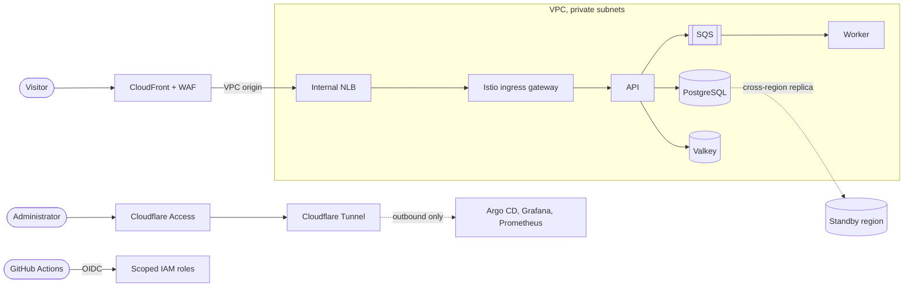
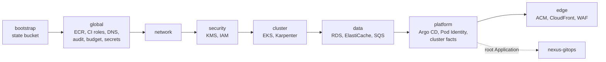
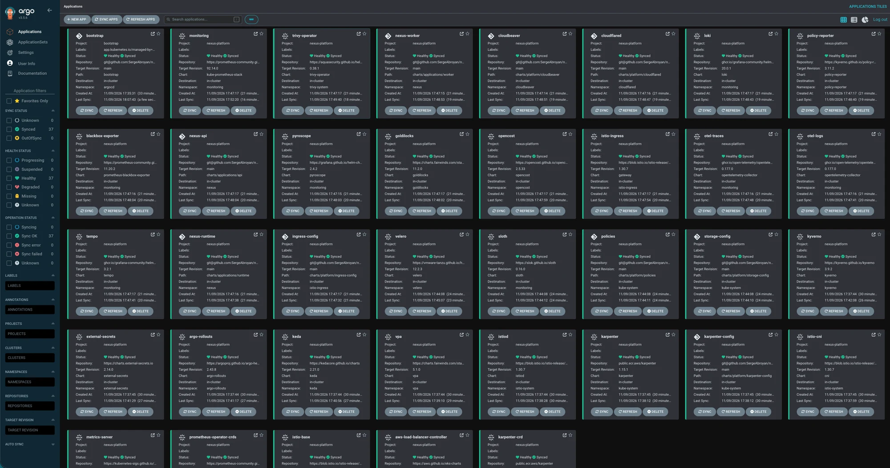
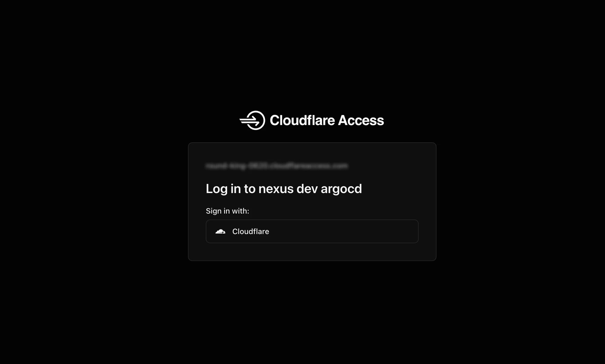
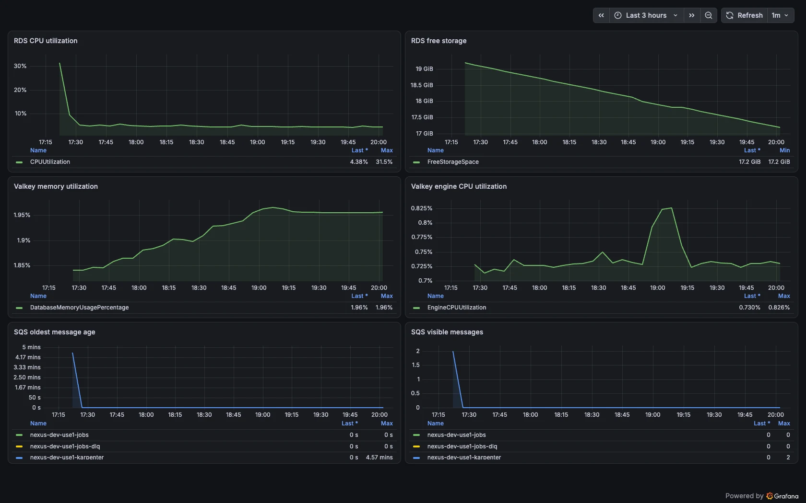
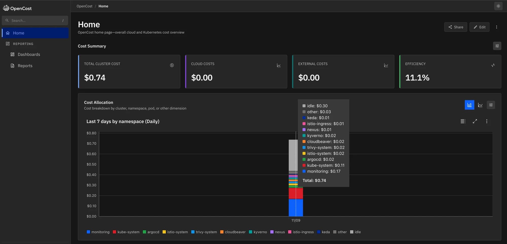

# Nexus Platform

AWS infrastructure for the Nexus platform, defined with Terraform modules and
composed with Terragrunt. One set of units builds every environment, from a
single-zone DEV on Spot capacity to a three-zone production with a warm standby
region, and hands each EKS cluster to Argo CD for everything that runs inside
it.

## Nexus

Nexus is a production-style platform I designed and built end to end: AWS
infrastructure, a GitOps-managed Kubernetes platform, and two services that
exercise it. Ownership is split across three repositories:

| Repository | Responsibility |
| --- | --- |
| **nexus-platform** | Account-wide resources, networking, EKS, data services, edge, Argo CD installation |
| [nexus-gitops](https://github.com/SergeAbroyan/nexus-gitops) | Every workload and add-on inside the clusters, reconciled by Argo CD |
| [nexus-applications](https://github.com/SergeAbroyan/nexus-applications) | Go API, Java worker, and the supply chain that builds, signs, and promotes them |

Environments are ephemeral. DEV is created for a working session and destroyed
afterwards; a rebuild from an empty account to 37 healthy Argo CD Applications
takes about an hour. A walkthrough with screenshots is on
[sergeabroyan.com/projects/nexus](https://sergeabroyan.com/projects/nexus/).

## Architecture



Units are applied in dependency order. `global` holds account-wide resources;
each environment and region then gets its own stack:



## Design

**Environment model.** Every unit type has a single Terragrunt definition in
`infrastructure/live/_units`. Environments differ only in data: two settings,
`availability_zone_count` and `standby_enabled`, set the shape, and the rest
follows. DEV runs one zone with a single NAT gateway; production runs three
zones with a NAT gateway per zone and a standby stack in `us-west-2`. Every
value tied to one deployment lives in `identity.hcl`, which Git ignores, so the
code deploys unchanged into any account.

**Network and edge.** Workloads run in private subnets; the cluster has no
public load balancer. CloudFront terminates TLS and reaches an internal NLB
through a VPC origin, with AWS WAF applying the AWS managed common, known bad
inputs, and IP reputation rule sets plus a per-IP rate limit. An S3 gateway
endpoint keeps image layers and backups off the NAT gateway.

**Compute.** EKS 1.36 with a small managed node group for system components and
Karpenter for everything else. DEV runs entirely on Spot; Karpenter receives
interruption notices through SQS and replaces nodes before AWS reclaims them.
Workloads authenticate to AWS with EKS Pod Identity, one role per service
account.

**Data.** PostgreSQL 18 on RDS with an AWS-managed master password, Valkey 9.1
on ElastiCache with IAM authentication and TLS, and an SQS queue with a
dead-letter queue. Each service encrypts with its own KMS key. Backups are
layered: RDS automated backups, AWS Backup plans, and Velero for Kubernetes
resources and volumes.

**Security.** No secret enters Git or Terraform state: RDS generates its own
password, and the Argo CD deploy key and OAuth client secret are read as
ephemeral values and passed as write-only attributes. CI reaches AWS through
GitHub OIDC without stored keys: the application role trusts only the `main`
branch of its repository, and each infrastructure role only the GitHub
environment of the same name. Admin
tools are published only through Cloudflare Tunnel, which dials out, behind
Cloudflare Access; `cloudflared` also validates the Access token on every
request. The account runs CloudTrail into an encrypted, retention-controlled
audit bucket, IAM Access Analyzer, and a monthly budget, with GuardDuty and
Security Hub available as switches.

**Resilience.** With `standby_enabled`, an environment runs active-passive
across `us-east-1` and `us-west-2`: a cross-region RDS replica, ECR
replication, replicated secrets, and a second CloudFront origin. Failover is a
scripted sequence of three applies, documented in
[Operations](docs/operations.md#disaster-recovery).

**Cost.** Spot capacity, a single NAT gateway, the S3 gateway endpoint, and
reduced control plane logging keep DEV near $0.40 an hour. Infracost reports the
cost change of every pull request, and DEV destroys cleanly, including secrets,
so it can be torn down every evening.

## Key decisions

| Decision | Record |
| --- | --- |
| One Terragrunt definition per unit type, shared by all environments | [ADR 0001](docs/adr/0001-terragrunt-units.md) |
| All environments in one AWS account, isolated by names, tags, KMS keys, and IAM | [ADR 0002](docs/adr/0002-one-aws-account.md) |
| Active-passive regions behind CloudFront | [ADR 0003](docs/adr/0003-active-passive-regions.md) |
| Secrets never in Terraform state or Git | [ADR 0004](docs/adr/0004-secrets-outside-state.md) |
| DEV entirely on Spot capacity | [ADR 0005](docs/adr/0005-spot-capacity-in-dev.md) |
| Cost estimates on pull requests instead of plans | [ADR 0006](docs/adr/0006-no-terraform-plan-on-pull-requests.md) |
| Alerts by email and Slack, without a paging service | [ADR 0007](docs/adr/0007-alerts-without-a-paging-service.md) |
| Image signatures stored as OCI referrers in ECR | [ADR 0008](docs/adr/0008-signatures-as-oci-referrers.md) |
| Layered backups: RDS, AWS Backup, Velero | [ADR 0009](docs/adr/0009-layered-backups.md) |
| Admin access through Cloudflare Tunnel and Access | [ADR 0010](docs/adr/0010-admin-access-through-cloudflare.md) |

## Stack

| Component | Version |
| --- | --- |
| Terraform | 1.11 or later, 1.17.0 in CI |
| Terragrunt | 1.1.5 or later, 1.2.1 in CI |
| AWS provider | 6.59 or later, below 7.0 |
| Amazon EKS | 1.36 |
| PostgreSQL / Valkey | 18 / 9.1 |
| Argo CD Helm chart | 10.11.6 |

Pull requests run Gitleaks over the history, `terraform fmt`, `terragrunt
validate`, `terraform validate` on every module, TFLint, and Checkov, and
Infracost comments with the cost difference. Deployments run from
the `Deploy Infrastructure` workflow, one environment at a time, behind GitHub
environment approvals.

## See it running

| | |
| --- | --- |
|  |  |
| 37 Applications synced and healthy after a rebuild | Admin tools behind Cloudflare Access, with no inbound port |
|  |  |
| RDS, ElastiCache, and SQS metrics from CloudWatch | Cost per namespace from OpenCost |

## Getting started

Requirements: Terraform, Terragrunt, the AWS CLI, `kubectl` 1.35 to 1.37,
credentials for the target account, and a domain you control.
[Getting started](docs/getting-started.md) has the complete procedure.

1. Copy `infrastructure/live/identity.example.hcl` to `identity.hcl` and set
   the account, domain, alert address, and GitHub owner. Terragrunt refuses
   `plan` and `apply` until this file exists.
2. Create the state bucket from `infrastructure/bootstrap` and migrate its own
   state into it.
3. Apply `infrastructure/live/global` and store the read-only deploy key that
   Argo CD uses for `nexus-gitops`.
4. Deploy an environment and connect to it:

   ```bash
   cd infrastructure/live/dev
   terragrunt run --all apply
   aws eks update-kubeconfig --name nexus-dev-use1 --region us-east-1
   kubectl get applications -n argocd
   ```

5. Configure the pipelines of the three repositories as described in
   [CI and deployment](docs/ci-cd.md).

With Cloudflare configured, the admin tools are served at
`https://<tool>-<environment>.<domain>`, for example `argocd-dev`.

## Teardown

Karpenter nodes and dynamically provisioned volumes live outside Terraform.
[Operations](docs/operations.md#destroying) gives the sequence: pause the Argo
CD application controller, remove node pools and disruption budgets, run
`terragrunt run --all destroy`, then clear volumes, snapshots, and network
interfaces that Kubernetes created. `global` remains at about $4 a month so the
next rebuild is a single apply.

## Repository layout

```text
infrastructure/
├── bootstrap/                 S3 bucket for Terraform state
├── modules/                   global, network, security, cluster, data, platform, edge
└── live/
    ├── root.hcl               Backend, providers, and version constraints
    ├── account.hcl            Settings shared by every environment
    ├── identity.example.hcl   Template for deployment-specific values
    ├── _units/                One Terragrunt definition per unit type
    ├── global/                Account-wide resources
    └── dev/ staging/ production/
docs/                          Guides, decision records, screenshots
.github/workflows/             Validation, deployment, cost estimates
```

## Documentation

| Page | Contents |
| --- | --- |
| [Getting started](docs/getting-started.md) | Prerequisites, deployment values, state bucket, first deployment |
| [Architecture](docs/architecture.md) | Environments, topology, repository structure, dependency order |
| [Kubernetes platform](docs/kubernetes-platform.md) | GitOps bridge, admin tools, Argo CD sign-in, admission policies, ingress |
| [Operations](docs/operations.md) | Scaling and destroying environments, disaster recovery, backups, resilience experiments |
| [Security](docs/security.md) | Account security services |
| [Observability](docs/observability.md) | Alarms and alert routing |
| [Cost](docs/cost.md) | Running cost and how it is controlled |
| [CI and deployment](docs/ci-cd.md) | Validation, deployment workflows, repository settings |
| [Decision records](docs/adr/README.md) | Context and consequences of each major choice |
