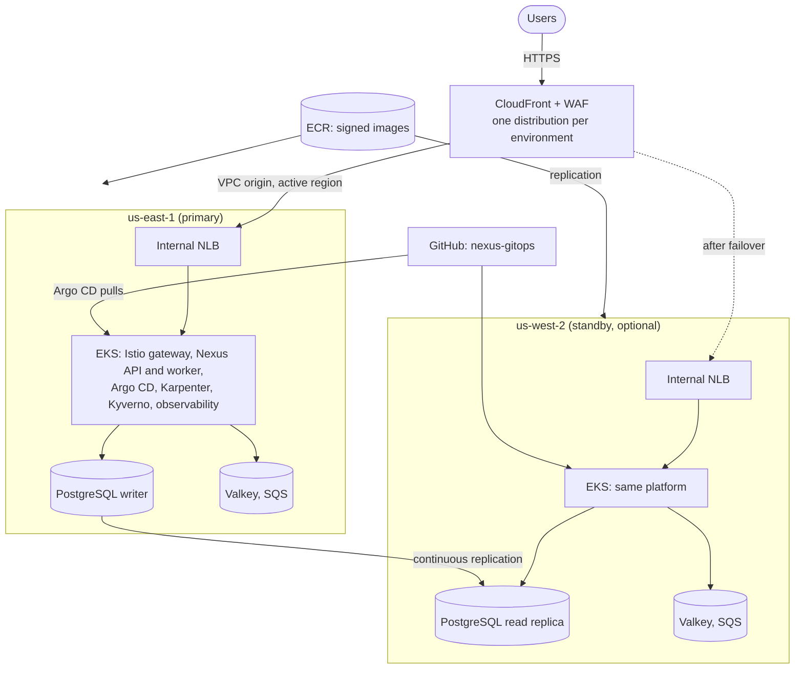

# Architecture

## What each environment deploys

| Environment | Regions | Availability Zones | Purpose |
| --- | --- | --- | --- |
| `dev` | `us-east-1` | 1 | Low-cost development on Spot instances |
| `staging` | `us-east-1`, standby `us-west-2` | 3 | Production-like testing |
| `production` | `us-east-1`, standby `us-west-2` | 3 | Highly available service |

The switches are in each `environment.hcl`:

- `standby_enabled` turns the `us-west-2` standby region on or off. When it is
  off, `terragrunt run --all` skips every `us-west-2` unit of that environment
  and refuses `plan` and `apply` inside them.
- `availability_zone_count` sets how many zones run nodes, NAT gateways, the
  database, the cache, and the load balancer. EKS and RDS require subnets in at
  least two zones, so subnets always exist in all three zones; they cost
  nothing, and with a count of 1 everything that runs is placed in the first
  zone.

## Architecture



- CloudFront is the only public entry point. It reaches each region's internal
  Network Load Balancer through a CloudFront VPC origin, so no load balancer is
  exposed to the internet. `active_region` decides which region receives
  traffic.
- In an environment with the standby enabled, the standby PostgreSQL database
  is a continuous read replica of the primary, and the standby API serves reads
  without changing the schema until the replica is promoted.
- With three zones, each region has a NAT gateway per zone, Multi-AZ
  PostgreSQL, Valkey replicas in other zones, system nodes in several zones,
  and at least two Karpenter controllers.

## Repository structure

```text
infrastructure/
├── bootstrap/            One-time Terraform state bucket
├── modules/              Seven reusable Terraform modules
│   ├── global/           GitHub CI roles, Route 53 zone, ECR and replication, budget,
│   │                     shared secrets, CloudTrail, Access Analyzer, optional
│   │                     GuardDuty, Security Hub, and Cloudflare DNS, Tunnel and Access
│   ├── network/          VPC, subnets, NAT gateways, S3 gateway endpoint, flow logs
│   ├── security/         KMS keys, Grafana secret, regional alert topic
│   ├── cluster/          EKS, managed system nodes, Karpenter AWS resources, FIS experiments
│   ├── data/             PostgreSQL, Valkey, SQS, CloudWatch alarms, AWS Backup
│   ├── platform/         Pod Identity roles, ingress NLB, Velero bucket, Argo CD and its seed objects
│   └── edge/             CloudFront, WAF, TLS certificate, application DNS records
│                         in Route 53 and, when configured, Cloudflare
└── live/
    ├── root.hcl          State backend, AWS provider, naming, region switch
    ├── identity.example.hcl  Template for identity.hcl, the ignored file with your personal values
    ├── account.hcl       Account-wide settings shared by every environment
    ├── _units/           One definition per unit type
    ├── global/           Account-wide unit, applied once
    ├── dev/
    │   ├── environment.hcl
    │   ├── edge/
    │   ├── us-east-1/    region.hcl, network, security, cluster, data, platform
    │   └── us-west-2/    region.hcl, network, security, cluster, data, platform
    ├── staging/          Same layout as dev
    └── production/       Same layout as dev
.github/workflows/
├── validate.yaml             Formatting, validation, TFLint, and Checkov
├── deploy.yaml               Plan or apply one environment on demand
└── infracost.yaml            Monthly cost change of every pull request
.pre-commit-config.yaml       Local checks before every commit
docs/                         Getting started, architecture, operations, security, cost, CI
└── adr/                      Architecture decision records
```

The [architecture decision records](adr/README.md) explain the main
choices and the alternatives that were rejected.

Each unit folder holds a small `terragrunt.hcl` that includes `root.hcl` and its
definition in `_units/`, so every environment and region uses the same unit
code. Settings live in four places:

- `identity.hcl`: every value that belongs to the owner rather than the
  project: the AWS account ID, the domain, the alert email, the GitHub owner
  and its permanent numeric ID, and the administrators' IAM users, GitHub
  logins, and IP ranges. GitHub now identifies workflow runs to AWS by that
  ID as well as the name, so the CI roles trust both forms; find the ID with
  `curl https://api.github.com/users/<owner>`. Git ignores this file; it is
  created from `identity.example.hcl`, so someone who forks the project
  writes only this file.
- `account.hcl`: project settings shared by every environment: regions,
  repositories, GuardDuty, Security Hub, audit logs, budget, and container
  registry. It reads its personal values from
  `identity.hcl`.
- `<environment>/environment.hcl`: the switches above and every sizing and
  retention setting of that environment
- `<environment>/<region>/region.hcl`: the region's network ranges; each
  environment and region uses its own non-overlapping `/16`

The `global` unit is shared because all environments live in one AWS account.
The GitHub OIDC provider, the ECR repositories, the Route 53 zone, and the
budget can exist only once per account, and images are promoted between
environments by commit SHA from the same repositories. `global` also creates
one infrastructure CI role per environment and the secrets that every cluster
reads: the GitOps deploy key, the Slack webhook URL, and the GitHub OAuth
client secret.

Resources are named `nexus` for account-wide resources, `nexus-<environment>`
for the environment edge, and `nexus-<environment>-<region code>` for regional
resources, for example `nexus-dev-use1`.

## Dependency order

```text
global (applied once)

Each enabled region:   network ──┐
                       security ─┼─► cluster ─► data ─► platform
                       global ───┘

us-west-2/data also waits for us-east-1/data, the replica source.
edge waits for global and for the platform unit of each enabled region.
```

`terragrunt dag graph --working-dir infrastructure/live/dev` prints the graph.
Independent units run in parallel, and destroy uses the reverse order.
